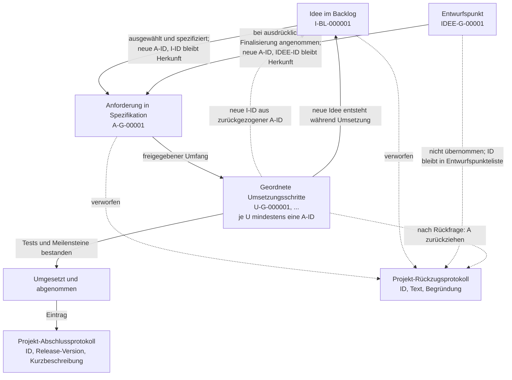

# Projektweite Anforderungs- und Umsetzungsnummerierung

**Status:** Projektregel; Entwurfs- und IDEE-Regeln am 26.10.2026 ergänzt  
**Geltungsbereich:** Projektweit für Spezifikationsentwürfe,
Entwurfspunkte, Anforderungen, Backlog-Ideen, Umsetzungsschritte sowie
Python/C++-Interfaces.

Diese Instruction enthält die vollständige Regelung; eine separate
Nummerierungs-Anweisung wird nicht parallel gepflegt.

Eine Anforderung (`A-…`) wird ausschließlich in einer Spezifikation geführt.
Ein Entwurfspunkt (`IDEE-…`) wird ausschließlich in der separaten
Entwurfspunkteliste des Projekts geführt. Eine Backlog-Idee (`I-…`) wird
ausschließlich im Backlog geführt. Umsetzungsschritte (`U-…`) stehen im
zugehörigen Umsetzungsplan. Übergänge ändern nicht rückwirkend die Kennung
eines bestehenden Eintrags.

Entwürfe und Entwurfspunktelisten sind nicht freigegebene Arbeitsstände.
Sie erhalten keine A- oder U-Kennungen und begründen keinen
Umsetzungsauftrag.

## Grundregeln

1. Jede Anforderung erhält eine eigene eindeutige Kennung. Eine Anforderung
   kann aus mehreren zusammengehörigen, gemeinsam abnehmbaren Details
   bestehen; einzeln prüfbare Anforderungen sollen nicht unnötig gebündelt
   werden. Ein Anforderungspunkt darf mehrere Details umfassen, sofern sie
   einen kohärenten Anforderungsvertrag bilden und gemeinsam abgenommen
   werden.
2. Eine einmal vergebene Kennung wird nie für einen anderen Inhalt
   wiederverwendet. Sie kann zurückgezogen werden; zurückgezogene Kennungen
   bleiben als solche nachvollziehbar.
3. Neu vergebene Anforderungen erhalten eine projektbezogene,
   versionsunabhängige Kennung. In SegelPhysik-GUI lautet das Format:

   ```text
   A-G-<laufende-nummer>
   ```

   Beispiel: `A-G-00001`. Der A-G-Zähler läuft projektweit über alle
   Versionen fort und wird nicht mit einem neuen Release zurückgesetzt.
   Ältere Kennungen dürfen weiterhin als historische Referenz verwendet
   werden. Bereits vergebene versionsbezogene Kennungen bleiben unverändert;
   eine Umstellung erfolgt nur nach ausdrücklichem Auftrag gemäß Abschnitt
   1a.
4. Nicht finale Spezifikationsentwürfe führen ihre offenen fachlichen
   Punkte nicht als A-Anforderungen, sondern verweisen auf eine separate
   Entwurfspunkteliste. Für SegelPhysik-GUI lautet deren projektweiter,
   releaseunabhängiger Nummernraum:

   ```text
   IDEE-G-<laufende-nummer>
   ```

   Beispiel: `IDEE-G-00001`. Der IDEE-G-Zähler läuft projektweit fort und
   wird weder beim Finalisieren eines Entwurfs noch mit einem neuen Release
   zurückgesetzt. Jeder Punkt erhält Status und Verweis auf den zugehörigen
   Entwurf beziehungsweise Abschnitt. Für Core gilt entsprechend
   `IDEE-C-<laufende-nummer>`.
5. Erst wenn der Nutzer die Spezifikation ausdrücklich finalisieren lässt,
   werden die angenommenen Entwurfspunkte in der endgültigen Spezifikation
   als neue `A-G-<laufende-nummer>`-Anforderungen geführt. Die Liste
   dokumentiert die Zuordnung jeder IDEE-ID zu ihrer neuen A-ID. Nicht
   übernommene, zurückgestellte oder verworfene Punkte verbleiben mit ihrer
   IDEE-ID und Abschlussstatus in der Liste. IDEE-IDs werden nie als A-IDs
   wiederverwendet; die IDEE-ID bleibt als Herkunftsverweis erhalten. Für
   Core werden die neuen Anforderungen als `A-C-<laufende-nummer>` vergeben.
6. Wird eine Anforderung ins Backlog verschoben, wird sie als Idee mit einer
   `I-…`-Kennung geführt. Neue Backlog-Ideen verwenden das Format
   `I-BL-<laufende-nummer>`, zum Beispiel `I-BL-000001`. Da `BL` keine
   Versionsangabe enthält, läuft dieser Zähler projektweit fort und wird
   nicht mit einem neuen Versionsschritt zurückgesetzt.
7. Eine Backlog-Idee erhält erst dann eine neue Anforderungskennung
   `A-G-<laufende-nummer>`, wenn sie in eine aktuelle Spezifikation
   übernommen wird. Die A-ID wird neu vergeben; die frühere I-ID bleibt als
   Herkunftsverweis erhalten.
8. Jeder Umsetzungsschritt erhält eine eindeutige, projektbezogene,
   versionsunabhängige Kennung:

   ```text
   U-G-<laufende-nummer>
   ```

   Beispiel: `U-G-000001`. Der U-G-Zähler läuft projektweit über alle
   Versionen fort und wird nicht mit einem neuen Release zurückgesetzt.
9. Jeder neue Umsetzungsschritt verweist auf mindestens eine passende
   Anforderungskennung, normalerweise `A-G-…`. Bereits vergebene,
   nicht umgestellte A-Kennungen bleiben gültige Verweise. Ein
   Umsetzungsschritt darf mehrere Anforderungen gemeinsam umsetzen;
   Anforderungen müssen nicht jeweils in einem eigenen Umsetzungsschritt
   implementiert werden. Am Ende der Umsetzung müssen alle aktiven
   Anforderungen der betreffenden Version mindestens einem
   Umsetzungsschritt zugeordnet und über die geplanten Meilensteine
   nachgewiesen sein. Umsetzungsschritte sind so zu ordnen, dass ihre
   Abhängigkeiten eingehalten werden und sie nacheinander erarbeitet und
   integriert werden können.

## Dauerhafte Kennungen für Python/C++-Interfaces

- Jedes einzelne Interface erhält eine eindeutige Kennung `CPPI-xxxx`
  (C++Interface), beginnend mit `CPPI-0001`. Die laufende Nummer wird
  mindestens vierstellig mit Nullen aufgefüllt und bei Bedarf verlängert.
- Der CPPI-Zähler läuft projektweit über alle Versionen und Revisionen
  hinweg fort; er wird nicht zurückgesetzt.
- Maßgebliche Vergabestelle ist das projektlokale Schnittstellenregister
  Python/C++, sofern dieses Projekt eines führt. Jeder exportierte
  Datentyp, jede Funktion und jede qualifizierte Kontextmethode erhält
  einen eigenen Eintrag, keine Sammel-ID pro Familie.
- Konkrete geplante Interfaces erhalten bereits vor der Implementierung
  eine CPPI-ID. Noch nicht konkretisierte Arbeits- oder Abnahmebereiche
  erhalten keine Interface-Kennung.
- Vor einer Vergabe aktive und archivierte Einträge prüfen. Neue Nummern
  liegen oberhalb der höchsten jemals vergebenen Nummer; Lücken werden
  nicht aufgefüllt. Bestehende IDs niemals umnummerieren oder für andere
  Schnittstellen wiederverwenden.
- Statusänderungen und Umbenennungen derselben Schnittstelle behalten die
  CPPI-ID; den bisherigen Namen nachvollziehbar dokumentieren. Eine neue
  Ersatzschnittstelle erhält eine neue ID mit Verweis auf die ersetzte ID.
  Stillgelegte oder verworfene Einträge bleiben mit ursprünglicher ID,
  Begründung und gegebenenfalls Ersatz im Register erhalten.
- CPPI-IDs ergänzen A-/U-Verweise und ersetzen weder Anforderungs- noch
  Umsetzungsschrittkennungen.

## Ablauf und Beziehungen



## Kennungs- und Rückverfolgbarkeitsprinzip

```text
IDEE-G-00001
   │ bei ausdrücklicher Finalisierung ausgewählt
   ▼
A-G-00001 ─────────────────┐
                            ├── referenziert durch U-G-000001
I-BL-000001 ───────────────┘
   (separater Backlog-Übergang)
```

Spezifikationen und Umsetzungspläne gehören weiterhin zu einem bestimmten
Versionsschritt. Neue A- und U-Kennungen enthalten jedoch keine
Versionsangabe: Ihre projektweiten Zähler werden über Releases hinweg
fortgeführt. Bisherige
versionsbezogene Kennungen bleiben gültig, bis sie ausdrücklich nach
Abschnitt 1a umgestellt werden. Umsetzungsschritte nennen die für ihre
Umsetzung gültigen Anforderungs-IDs. IDs sind durch Typpräfix,
Projektkennung und laufende Nummer eindeutig; ein zusätzlicher Namens-Slug
wird nicht verwendet. Historische Kennungen werden bei einer freigegebenen
Migration nach Abschnitt 1a in einer eindeutigen Zuordnung erfasst.

## Abgestimmte Prozessregeln

### 1. Übergang zwischen Anforderung und Backlog-Idee

Die Kennung selbst wird nicht umgeschrieben. Wenn eine Anforderung aus einer
Spezifikation verworfen oder – nach Rückfrage und Zustimmung des Nutzers –
während ihrer Umsetzung ins Backlog verschoben wird:

- Die bisherige `A-…`-Kennung wird zurückgezogen und nie wieder vergeben.
- Der aktive normative Punkt wird aus dem aktiven Anforderungsteil der
  Spezifikation entfernt und dort gemäß dem bestehenden
  Spezifikationsverfahren unter seiner ursprünglichen ID als zurückgezogen
  archiviert.
- Die Backlog-Idee erhält eine neue `I-BL-…`-Kennung.
- Beide Kennungen werden miteinander verknüpft (zum Beispiel
  „ersetzt/abgeleitet aus“).
- Bei späterer Übernahme erhält die Idee eine neue `A-G-…`-Kennung; die
  `I-BL-…`-Kennung bleibt als historische Herkunft erhalten.

Damit ist die inhaltliche Verschiebung von A nach I gemeint, nicht eine
Änderung der bereits vergebenen Kennung. Eine Anforderung wird niemals
ohne vorherige Rückfrage und Zustimmung aus einem laufenden Umsetzungsschritt
ins Backlog verschoben. Neue Ideen, die während der Umsetzung entstehen,
erhalten direkt eine neue `I-BL-…`-Kennung und werden im Backlog erfasst; sie
werden nicht ohne Spezifikationsaufnahme als Anforderungen behandelt.

### 1a. Übergang von einem alten Nummerierungsschema

Wenn eine bestehende Spezifikation von einem früheren Nummerierungsschema
auf das aktuelle Schema umgestellt wird:

- Die Anforderungen werden im aktiven Spezifikationstext ausschließlich
  mit neuen, projektbezogenen `A-G-<laufende-nummer>`-IDs bezeichnet.
- Am Ende der Spezifikation wird ein Anhang mit einer eindeutigen Zuordnung
  jeder alten Kennung zu ihrer neuen A-ID ergänzt.
- Alte Kennungen bleiben als historische Verweise dauerhaft reserviert und
  werden weder gelöscht noch für andere Inhalte wiederverwendet. Sie sind
  nach der Umstellung keine aktiven Anforderungskennungen.
- Neue Verweise in Spezifikation, Umsetzungsplan, Tests und Protokollen
  verwenden die neue A-ID. Die alte Kennung darf dort nur im ausdrücklich
  historischen Zuordnungskontext erscheinen.
- Die Umstellung ändert keine Anforderung inhaltlich. Wird eine Anforderung
  dabei geteilt, zusammengeführt oder fachlich geändert, ist dies gesondert
  nachvollziehbar zu dokumentieren; eine alte ID darf nicht mehrdeutig auf
  mehrere neue Anforderungen zeigen.

Diese Übergangsregel gilt projektweit und unabhängig davon, in welchem
Versions- oder Revisionsordner die Spezifikation liegt.

### 2. Umsetzung und zentrale Protokolle

Nach erfolgreicher Umsetzung und Abnahme wird jede erfüllte Anforderung in
dem projektlokalen Abschlussprotokoll eingetragen, sofern ein solches
Protokoll eingerichtet ist. Der Eintrag enthält mindestens die A-ID, die
Release-Version und eine kurze Beschreibung. Der Log-Eintrag dokumentiert
den Abschluss; die Spezifikation bleibt als fachliche Quelle erhalten.
Der Logeintrag ist ein Abschlussnachweis und verschiebt die Anforderung
nicht aus ihrer Spezifikation.

Verworfene oder zurückgezogene Anforderungen und Ideen werden in
dem projektlokalen Rückzugsprotokoll festgehalten, sofern dieses
eingerichtet ist. Ein Eintrag enthält mindestens die ursprüngliche ID, den
Anforderungstext beziehungsweise Ideentext und eine kurze Begründung. Bei
einem Übergang von A zu I werden beide IDs und ihre Beziehung festgehalten:
die zurückgezogene A-ID und die neu angelegte I-BL-ID. Eine verworfene
Anforderung erhält außerdem den beschriebenen Archivvermerk in ihrer
Spezifikation. Entwurfspunkte und deren Status werden in der separaten
Entwurfspunkteliste geführt; nicht übernommene Punkte werden nicht zu
Anforderungen oder Backlog-Ideen umetikettiert.

IDs der umgesetzten und zurückgezogenen Einträge bleiben dauerhaft reserviert
und werden niemals wiederverwendet. Die Protokolle sind Ergänzungen zur
Spezifikation und zum Backlog, keine Ablösung ihrer Einträge oder
Anforderungsquelle.

### 3. Granularität und Zähler

Jede eigenständig prüfbare Anforderung erhält eine ID.
Zusammengehörige Einzelaspekte dürfen als ein Anforderungspunkt beschrieben
werden, wenn sie einen kohärenten, gemeinsam abnehmbaren Vertrag bilden.

Der Zähler besteht aus einer projektweit fortlaufenden Nummer. Typpräfix und
Projektkennung erklären die Bedeutung der Kennung. Ein zusätzlicher
Namens-Slug wird nicht verwendet.

- A-G-Zähler laufen projektweit über alle Releases fort.
- U-G-Zähler laufen projektweit über alle Releases fort.
- IDEE-G-Zähler laufen projektweit für Entwurfspunkte fort.
- I-BL-Zähler laufen im projektweiten Backlog fort, da `BL` keine Version
  kodiert.
- Die Nummer wird bei Bedarf verlängert, nie abgeschnitten oder
  wiederverwendet.

Beispiele für die abgestimmten Formate:

```text
A-G-00001
IDEE-G-00001
I-BL-000001
U-G-000001
```

### 4. Umsetzungsschritte, Reihenfolge und Meilensteine

Umsetzungsschritte werden so zugeschnitten, dass sie in einer sinnvollen,
abhängigkeitsgerechten Reihenfolge erstellt und integriert werden können.
Technisch zusammengehörige Anforderungen dürfen im selben Schritt
umgesetzt werden. Es ist nicht erforderlich und nicht immer sinnvoll, jede
Anforderung isoliert einzeln zu implementieren. Schritte bauen auf ihren
Voraussetzungen auf und werden mit gruppierten, prüfbaren Meilensteinen
abgenommen.

Jeder Umsetzungsschritt erhält eine eindeutige `U-G-…`-ID und verweist auf
mindestens eine `A-G-…`-ID. Die Umsetzungsschritte sollen Abhängigkeiten
sichtbar machen und an prüfbaren Meilensteinen enden. Meilensteintests und
Abnahmekriterien dürfen mehrere zusammengehörige Anforderungen gemeinsam
verifizieren; eine eigene Test-ID oder ein eigener Umsetzungsschritt pro
Anforderung ist nicht vorgeschrieben. Diese Regel bedeutet keine 1:1-
Zuordnung: Ein U-Schritt darf mehrere A-IDs bündeln, und eine A-ID darf
mehrere abhängige U-Schritte benötigen.

Zur Abnahme jeder Version wird eine Rückverfolgbarkeitsmatrix geführt:

| Aktive Anforderungs-ID | Spezifikation/Abschnitt | Umsetzungsschritt(e) | Test/Abnahmekriterium | Status |
|---|---|---|---|---|
| `A-G-…` | Fundstelle | ein oder mehrere passende `U-G-…` | zugehöriger Meilenstein-/Testnachweis | offen/erfüllt |

Am Ende müssen alle aktiven Anforderungen der Version in mindestens einem
Umsetzungsschritt referenziert und durch den betreffenden Meilenstein
nachgewiesen sein. Eine Anforderung, die nicht mehr Teil der aktuellen
Version ist, wird nicht stillschweigend ausgelassen: Sie wird zurückgezogen
und gegebenenfalls als neue Backlog-Idee mit Herkunftsverweis geführt.

### 5. Eindeutigkeit über Releases

Die vollständige Kennung ist innerhalb des jeweiligen Projekts eindeutig.
A-G-, U-G-, IDEE-G- und I-BL-Zähler laufen projektweit fort und werden bei
einem neuen Release nicht zurückgesetzt. IDs werden nie neu vergeben, auch
nicht nach Löschung oder Archivierung des zugehörigen Dokuments. Für Core
gelten eigenständige A-C-, U-C- und IDEE-C-Zähler.

## Anwendung bei Projektarbeiten

- Vor jeder Neuvergabe aktive und archivierte IDs prüfen. Bestehende
  Kennungen nicht umnummerieren oder wiederverwenden. Eine Umstellung alter
  Spec-Kennungen nur auf ausdrücklichen Auftrag durchführen und die
  historische Zuordnung nach Abschnitt 1a erhalten.
- Jede Anforderung bleibt in ihrer Ursprungsspezifikation dokumentiert:
  aktive Punkte im Anforderungsteil, zurückgezogene oder verlegte Punkte
  unter ihrer ursprünglichen Kennung im vorgeschriebenen Archivabschnitt.
  A-/U-Verweise und Tests konsistent verknüpfen; fehlende Zuordnungen und
  Nachweise offen nennen.
- Eine Anforderung während laufender Umsetzung nur nach Zustimmung des
  Nutzers ins Backlog überführen. Fehlende Angaben nicht erraten. Den Ordner
  `doc/Backlog/Ideen/` nicht als Informationsquelle verwenden, außer der
  Nutzer verlangt ausdrücklich konkrete Inhalte daraus.
- Abschließend doppelte oder fehlende IDs, Wiederverwendung, Abhängigkeiten
  und Nachweislücken prüfen. Betroffene Dokumente und Kennungen knapp
  benennen; keine unbelegte Vollständigkeit behaupten.
- Bei Spezifikationsanfragen aktive Punkte nach Kennung tabellarisch
  auflisten, sofern nicht anders gewünscht.
- Bei Spezifikationsentwürfen keine A- oder U-Kennungen vorwegnehmen.
  Offene Punkte in der getrennten Entwurfspunkteliste mit der passenden
  IDEE-Projektkennung führen; eine Überführung in A-Kennungen nur bei
  ausdrücklicher Finalisierung durchführen und dort die Zuordnung
  dokumentieren.

## Freigabe

Diese Instruction ist die maßgebliche Nummerierungsregel für das GUI-
Projekt. Änderungen an der Nummerierungsregel selbst benötigen eine spätere
ausdrückliche Nutzerentscheidung; bestehende Kennungen bleiben unverändert.
Das Core-Projekt verwendet dieselbe Regelstruktur mit eigenständigen `C`-
Kennungen und Zählern.
