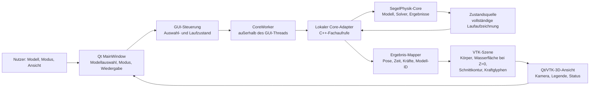

# Spezifikation GUI-Erstausbau: Simulation und Kräfte darstellen

**Status: FINAL – finalisiert auf Nutzerauftrag am 26.10.2026.**
**Version:** G-0.1 (alle aktiven Anforderungen umgesetzt in G-0.1)
**Stand:** 26.10.2026
**Quellen:** GUI-Vertrag und Darstellungsgrundlage aus
`Dokumentationen/GUI_Uebergabe_2026-10-26.zip`; ausschließlich für den
Abschnitt „Laufzeitmessung und Zeitanzeige“ zusätzlich
`CORE/Spezifikationen/Spezifikation_Hydrostatikkern.md`, A-C-00021 bis
A-C-00024. Die Core-Zeitmessungspunkte werden hier als GUI-Anforderung (A-G-00006)
übertragen, nicht als Core-Implementierungszusage.

Diese Spezifikation beschreibt eine erste Desktop-GUI für die Auswahl eines
Modells sowie die Darstellung statischer und dynamischer Simulationen. Sie
leitet keine Anforderungen aus dem Altprojekt ab. Die aktiven Anforderungen
tragen die Kennungen A-G-00001 bis A-G-00008. Die Herkunft aus den
Entwurfspunkten und deren weiterhin offene Restfragen stehen in der
[Entwurfspunkteliste](Entwurfspunkte/GUI_Erstausbau.json); Restfragen sind
keine Anforderungen dieser Version.

Der zugehörige
[Umsetzungsplan](../Umsetzungsplaene/Umsetzungsplan_GUI_Erstausbau.md)
enthält Umsetzungsschritte (U-G-000001 ff.), Meilensteine, Nachweise und die
Rückverfolgbarkeitsmatrix.

## 1. Ziel und Umfang

Die erste Ausbaustufe soll eine gut lesbare 3D-Ansicht des ausgewählten
Körpermodells im Wasser bieten. Sie soll statische und dynamische
Simulationsergebnisse anzeigen, die zugehörigen Kraftpfeile einblenden und
den Wechsel zwischen den Darstellungsmodi sowie die Körperauswahl ermöglichen.

Die Oberfläche ist zunächst eine Desktop-Anwendung. Die übergebene
Architekturrichtung ist C++ mit Qt 6 Widgets und VTK. Qt und VTK bleiben
ausschließlich in der GUI; die Physik bleibt im C++-Core. Ein lokaler Adapter
verbindet beide im selben Prozess. **Die GUI muss den Core selbständig über
diesen Adapter aufrufen können** (A-G-00001, siehe Abschnitt 2): Sie stößt Modellprüfung und statische bzw.
dynamische Läufe aus ihrer eigenen Bedienoberfläche an, übergibt Modell und
Laufoptionen an die Core-Funktionen und übernimmt Laufbericht, Zustände sowie
Fehler zurück. Es darf kein separater manueller Aufruf der CLI oder ein
vorgeschalteter externer Prozess erforderlich sein. Das bloße Anzeigen
vorgefertigter Ergebnisdateien erfüllt diese Anforderung nicht; solche Dateien
dienen als Referenz- und Testeingaben. Für lokale Bibliotheksaufrufe ist JSON
kein vorgeschriebener Transport.

### Gesicherte Ausgangslage aus der Core-Übergabe

- Der Core bietet Modellprüfung, Pose, Hydrostatik, Gleichgewicht,
  Dynamikschritt, synchrone Gesamtläufe, Ergebnisserialisierung und einen
  Fehlerkatalog.
- Die öffentliche Gesamtlauf-Funktion `segelphysik::simulieren` nimmt
  Modell- und Ausgabepfad sowie `Laufoptionen` entgegen und liefert einen
  `Laufbericht`. Zu den Optionen gehören Modus, Startzustand, Dauer,
  Schrittweite, Ausgabeintervall, JSONL-Ausgabe und ein Abbruch-Flag.
- `segelphysik::pruefung_json` prüft ein Modell. `segelphysik::zustand_json`
  serialisiert einen Ergebniszustand; `segelphysik::fehlerdokumentation_json`
  liefert den Fehlerkatalog.
- Die Ergebnisaufzeichnung Version 1 liegt als JSONL oder JSON-Array vor.
  Vollständige Referenzaufzeichnungen für statischen und dynamischen Lauf
  sind im Übergabepaket enthalten.
- Ergebniszustände enthalten unter anderem Modellidentität und -fassung,
  Status und Diagnose, Pose, Zeit, dynamisch zusätzlich Schritt und
  Geschwindigkeiten, Verdrängungsvolumen sowie Kraft-/Momentenbeiträge.
- Kräfte und Ansatzpunkte sind im Modellbezug angegeben. Ansatzpunkte werden
  bei der Darstellung rotiert und verschoben; Vektoren werden nur rotiert.
  SI-Einheiten und Quaternionreihenfolge `xyzw` sind einzuhalten. Die GUI
  bestimmt grafische Maßstäbe.
- Die Ruhewasseroberfläche liegt im Weltsystem bei `Z = 0`. Die
  Modellpose verwendet den festen Modellursprung. Grafisches Clipping darf
  die Core-Physik nicht verändern.
- Ein fertiger GUI-Adapter, eine asynchrone Sitzungs-/Befehls-API, ein
  Live-Abonnement und ein binärer Live-Snapshot sind noch nicht vorhanden.
  Ein synchroner Gesamtlauf darf deshalb nicht im Oberflächenthread laufen.
- Die Übergabe nennt das Quaderbeispiel als startfähige Referenz. Sie weist
  zugleich darauf hin, dass Folkeboot und Optimist derzeit abgelehnt werden
  und dem 420er Hydrostatikmasse fehlt. Daraus folgt keine Zusage, dass alle
  Beispielmodelle simulierbar oder als auswählbare Simulationskörper geeignet
  sind.

## 2. Anforderungen und Abnahmekriterien

| ID | Anforderung | Herkunft | Version | Status |
|---|---|---|---|---|
| A-G-00001 | GUI ruft den Core selbständig auf | Abschnitt 1, Nutzerauftrag | G-0.1 | umgesetzt |
| A-G-00002 | Modell auswählen und prüfen, Modellordner-Katalog | IDEE-G-00001 (teilweise) | G-0.1 | umgesetzt |
| A-G-00003 | Körper und Wasseroberfläche darstellen | Spezifikationsentwurf | G-0.1 | umgesetzt |
| A-G-00004 | Statische Simulation darstellen | Spezifikationsentwurf | G-0.1 | umgesetzt |
| A-G-00005 | Dynamische Simulation live und Rückblick | IDEE-G-00002 (teilweise) | G-0.1 | umgesetzt |
| A-G-00006 | Laufzeitmessung und Zeitanzeige | Spezifikationsentwurf, A-C-00021 bis A-C-00024 | G-0.1 | umgesetzt; Fehler-/Abbruchpfad ohne Referenzfall |
| A-G-00007 | Kraftpfeile anzeigen | Spezifikationsentwurf | G-0.1 | umgesetzt |
| A-G-00008 | Wechsel zwischen den Modi | Spezifikationsentwurf | G-0.1 | umgesetzt |

### A-G-00001 – GUI ruft den Core selbständig auf

**Version:** G-0.1 · **Status:** umgesetzt

Die GUI stößt Modellprüfung sowie statische und dynamische Läufe aus ihrer
eigenen Bedienoberfläche über den lokalen Adapter an und übernimmt
Laufbericht, Zustände und Fehler direkt vom eingebundenen Core (Details
siehe Abschnitt 1). Kein CLI-Aufruf und kein externer Prozess sind nötig.

**Abnahme:** Prüfung und Läufe werden in der GUI gestartet und liefern
Core-Ergebnisse, ohne dass vorher eine Ergebnisdatei erzeugt werden muss.

### A-G-00002 – Modell auswählen und prüfen

**Version:** G-0.1 · **Status:** umgesetzt

Die GUI stellt eine erkennbare Auswahl des aktiven Modells bereit. Die
auswählbaren Modelle werden automatisch aus dem Inhalt des gewählten
Modellordners angezeigt (je `modell.json` im Ordner oder einem Unterordner)
und bei Änderungen des Ordners aktualisiert. Nach einer
Auswahl prüft sie das Modell über den Core, bevor sie Simulationsergebnisse
anzeigt. Ein abgelehntes oder unvollständiges Modell wird nicht als
erfolgreich geladen dargestellt; die Diagnose wird dem Nutzer angezeigt.
Die Auswahl darf nicht vortäuschen, dass ein vom Core abgelehntes Modell
simulierbar ist.

**Abnahme:** Die Modelle des Modellordners erscheinen ohne manuelle
Dateiauswahl. Ein verfügbares gültiges Modell kann ausgewählt,
geprüft und in der 3D-Ansicht dargestellt werden. Für ein ungültiges Modell
werden Prüfstatus und Diagnose sichtbar; ein vorheriges Ergebnis wird nicht
als Ergebnis des neu ausgewählten Modells weiterverwendet.
Die Prüfung wird durch die GUI selbst ausgelöst und direkt vom eingebundenen
Core beantwortet, nicht durch einen vorausgesetzten externen CLI-Lauf.

### A-G-00003 – Körper und Wasseroberfläche darstellen

**Version:** G-0.1 · **Status:** umgesetzt

Die 3D-Ansicht zeigt die Geometrie des Modells in seiner Ergebnispose und eine
Wasseroberfläche auf Welthöhe `Z = 0`. Für den ersten Ausbau darf die
Wasserwirkung als grafische Überlagerung dargestellt werden: eine gut
erkennbare, transparente Wasserfläche und eine sichtbare Wasserlinie bzw.
Schnittkontur am Körper. Ein Clipping-/Schnittbild ist rein visuell und darf
weder Mesh noch Simulationsergebnis im Core verändern.

Die Darstellung soll Körper und Wasserlinie in üblichen Ansichten gut
unterscheidbar halten. Kamera und Szene sollen das Auswählen bzw. Betrachten
des aktiven Körpers ermöglichen. Die konkrete Auswahltechnik und ein
quantitatives Ziel für die Bildqualität sind noch offen.

**Abnahme:** Bei mindestens einem gültigen Referenzmodell sind
Körper, Wasserfläche und Wasserlinie gleichzeitig sichtbar. Das Umschalten
zwischen Ergebniszuständen aktualisiert die Körperpose, ohne die
Wasseroberfläche aus `Z = 0` zu verschieben. Die angezeigte Pose entspricht
der Modellidentität und -fassung des dargestellten Ergebniszustands.

### A-G-00004 – Statische Simulation darstellen

**Version:** G-0.1 · **Status:** umgesetzt

Ein statischer Lauf wird im Core als statischer Modus konfiguriert. Die GUI
zeigt den vom Core gelieferten Zustand und dessen Status, insbesondere ob das
Gleichgewicht konvergiert hat. Nicht konvergierte, unlösbare oder
abgebrochene Ergebnisse dürfen nicht wie ein erfolgreich konvergierter
Zustand erscheinen.

**Abnahme:** Für die statische Referenzaufzeichnung aus dem
Übergabepaket werden Körperpose, Wasserlinie, Ergebnisstatus und die
zugehörigen Kraftbeiträge angezeigt. Ein fehlgeschlagener Lauf wird mit
Core-Diagnose als solcher erkennbar gemacht. Zusätzlich kann die GUI über
ihre Bedienoberfläche selbst einen statischen Core-Lauf starten und dessen
Ergebnis abrufen; eine bereitgestellte Referenzaufzeichnung ersetzt diesen
Funktionsnachweis nicht.

### A-G-00005 – Dynamische Simulation live und Rückblick

**Version:** G-0.1 · **Status:** umgesetzt

Ein dynamischer Lauf wird mit den vom Nutzer gewählten Laufparametern (Dauer,
Schrittweite, optional Echtzeit-Takt) gestartet. Die GUI ruft dafür den Core
selbst schrittweise (`dynamikschritt`) in einem eigenen Worker-Thread auf und
zeigt den jeweils neuesten Zustand live an, ohne Vorausrechnung. Optional ist
der Lauf an die Wanduhr gekoppelt („Echtzeit“, 1 s Simulation = 1 s real);
ohne Takt rechnet der Core ungebremst. Die Darstellung bremst den Core nicht:
Der Worker speichert nur rohe Zustände, die Anzeige holt sich mit begrenzter
Bildrate den neuesten Zustand. Alle berechneten Zustände werden gespeichert
und lassen sich während und nach dem Lauf zurückblicken. Ein Lauf kann ohne
Dauer („bis Abbruch“) gestartet und jederzeit gestoppt werden. Zu jedem
Zeitpunkt gehören Körperpose, Zeit/Schritt und Kraftbeiträge aus demselben
Zustand zusammen. Die Core-Berechnung läuft nie im GUI-Oberflächenthread.

**Abnahme:** Ein dynamischer Lauf wird live dargestellt; mit Echtzeit-Takt
entspricht die Simulationszeit der Wanduhr. Ein ungetakteter Lauf liefert
dieselben Zustände wie der Core-Gesamtlauf `simulieren`. Gespeicherte Zustände
lassen sich zustandsweise zurückblicken; dabei ändern sich Pose,
Simulationszeit und Kraftpfeile gemeinsam und konsistent. Der Laufstatus
entscheidet über den Gesamterfolg; eine vorhandene Teilaufzeichnung allein
gilt nicht als erfolgreicher Lauf.

### A-G-00006 – Laufzeitmessung und Zeitanzeige

**Version:** G-0.1 · **Status:** umgesetzt; Fehler- und Abbruchpfad nicht mit
Referenzfall belegt

Die GUI zeigt für jeden statischen und dynamischen Gesamtlauf die vom Core
gemeldete reale Gesamtlaufzeit zusammen mit dem Laufstatus an. Die
Gesamtlaufzeit muss eine monotone Laufzeituhr verwenden und den Lauf
einschließlich laufbezogener Vorbereitung (Modellladen), Berechnung und
Abschluss der Ergebnisaufzeichnung umfassen. Prozessstart und Prozessende
liegen außerhalb dieser Messgrenze; das Schreiben des abschließenden
Laufzeitberichts darf ebenfalls außerhalb liegen. Die GUI darf diese Grenze
nicht als reine Solver- oder Renderzeit ausgeben.

Simulationszeit (`zeit_s`) und reale Gesamtlaufzeit sind getrennte Größen und
müssen mit verständlichen Bezeichnungen und Einheiten dargestellt werden.
Auch bei kontrolliert fehlgeschlagenen oder abgebrochenen Läufen gehören die
gemeldete Dauer und der tatsächliche Status zusammen; ein Fehler oder Abbruch
darf nicht als erfolgreicher Lauf erscheinen. Eine vorhandene
Teilaufzeichnung allein entscheidet nicht über den Gesamterfolg.

Detailmessungen dürfen im Normalbetrieb nicht aktiviert werden. Sie sind
ausschließlich für ausdrücklich gestartete Test-/Benchmarkläufe bestimmt und
dürfen weder durch die GUI still aktiviert noch als reguläre Laufzeiten
angezeigt werden. Die übertragenen Core-Messgrenzen sind vollständige
Operationen: Modellvorbereitung, Masseneigenschaften, Hydrostatikauswertung,
Ebenenschnitt, vollständige Gleichgewichtssuche, vollständiger dynamischer
Zeitschritt und Ergebnisaufzeichnung. Messungen elementarer innerer
Operationen wie einzelner Dreiecke sind kein GUI-Anzeigeziel. Verschachtelte
Messungen dürfen nicht unkommentiert zu einer Gesamtdauer addiert werden;
wiederholte Messungen benötigen Anzahl und aggregierte Dauer, Benchmark-
Wiederholungen geeignete Streuungsinformationen.

Die Core-Übergabe stellt im Laufbericht ein Feld für die Gesamtlaufzeit und
separate testaktive Messwerte bereit. Die GUI zeigt nur tatsächlich gelieferte
Messwerte und erfindet keine Detailzeiten. Wird später GUI-eigene
Zeitinstrumentierung eingeführt, müssen Messgrenze, Einheit,
Aktivierungsbedingung, Quellfundstelle und zugehöriger Test zentral
dokumentiert und implementierte Messpunkte vollständig gegen dieses Register
abgeglichen werden.

**Abnahme:** Erfolgs-, Fehler- und Abbruchläufe zeigen eine
endliche, nicht negative reale Gesamtdauer mit passendem Status. Die
Simulationszeit bleibt als getrennte Größe erkennbar. Ein normaler GUI-Lauf
aktiviert keine testexklusiven Detailmessungen; ein ausdrücklich gestarteter
instrumentierter Test zeigt nur die tatsächlich vorhandenen und eindeutig
benannten Messwerte.

### A-G-00007 – Kraftpfeile anzeigen

**Version:** G-0.1 · **Status:** umgesetzt

Die GUI stellt Kraftbeiträge aus dem Ergebniszustand als Pfeile dar. Für jeden
Pfeil verwendet sie den dokumentierten Angriffspunkt und Vektorbeitrag.
Angriffspunkte werden mit der Modellpose ins Weltsystem transformiert,
Kraftvektoren ausschließlich rotiert. Richtung und Länge werden aus den
Komponenten berechnet; die GUI wählt einen Darstellungsmaßstab. Nullvektoren
werden nicht mit einer erfundenen Richtung dargestellt.

Pfeile müssen dem jeweiligen Zustand und Modell zugeordnet bleiben. Die
Oberfläche muss Kraftart und Einheit so kenntlich machen, dass Gewicht und
Auftrieb unterscheidbar sind; konkrete Farben, Filter und Maßstabsregeln sind
offene Gestaltungsentscheidungen. Momente sind im Core-Ergebnisvertrag
vorhanden, aber eine Momentenvisualisierung ist kein zugesagter Teil dieses
ersten Umfangs.

**Abnahme:** Für alle nichtleeren Kraftbeiträge der
Referenzaufzeichnungen stimmen die dargestellten Ansatzpunkte und
Vektorrichtungen mit den Ergebnisdaten einschließlich der oben genannten
Transformationen überein. Mindestens Gewicht und Auftrieb sind über Legende
oder gleichwertige Kennzeichnung unterscheidbar. Pfeile eines anderen
Modells oder Simulationszustands bleiben nach Auswahl- bzw. Moduswechsel
nicht sichtbar.

### A-G-00008 – Wechsel zwischen den Modi

**Version:** G-0.1 · **Status:** umgesetzt

Die GUI bietet einen sichtbaren Wechsel zwischen statischer und dynamischer
Darstellung. Ein Moduswechsel verwendet nur Ergebnisse des ausgewählten
Modells und des gewählten Modus. Vorherige Pfeile, Zustände und
Wiedergabezeiger werden beim Wechsel ersetzt oder eindeutig dem alten Modus
zugeordnet; sie dürfen nicht unbemerkt mit dem neuen Modus vermischt werden.

**Abnahme:** Nach jedem Wechsel sind aktiver Modus und
zugehöriger Modell-/Ergebnisstand erkennbar. Ein statisches Ergebnis kann
nicht versehentlich als dynamischer Zustand oder umgekehrt angezeigt werden.

## 3. Softwarestruktur

Der GUI-Adapter bleibt die einzige Grenze zum Core. Qt-/VTK-Typen gelangen
nicht in den Core. Die Darstellung arbeitet mit vollständigen, konsistenten
Ergebniszuständen und deren Modellidentität/-fassung.



## 4. Ablauf und Funktionsaufrufe

Die Namen der Core-Funktionen im Ablauf sind die im Übergabepaket
dokumentierten öffentlichen Funktionen. Der GUI-Adapter und die
VTK-Aufbereitung sind GUI-Bausteine, keine Core-Schnittstellen. Das
Diagramm zeigt den statischen Gesamtlauf über `simulieren`. Für dynamische
Live-Läufe (A-G-00005) ruft der Worker stattdessen `lade_modell` und
wiederholt `dynamikschritt` auf; die Anzeige liest gespeicherte Zustände und
erzeugt `zustand_json` nur für angezeigte Zustände.

```mermaid
sequenceDiagram
    actor Nutzer
    participant Qt as Qt MainWindow / GUI-Steuerung
    participant Worker as CoreWorker
    participant Adapter as Lokaler Core-Adapter
    participant Core as C++-Core
    participant Mapper as Ergebnis-Mapper
    participant VTK as VTK-Szene

    Nutzer->>Qt: Modell auswählen
    Qt->>Worker: Modellprüfung starten
    Worker->>Adapter: pruefung_json(modellpfad, gueltig)
    Adapter->>Core: segelphysik::pruefung_json(...)
    Core-->>Adapter: Prüfstatus und Diagnose
    Adapter-->>Qt: Prüfresultat / Fehler anzeigen

    Nutzer->>Qt: Modus und Laufparameter wählen, Start
    Qt->>Worker: Laufauftrag (Modell-ID, Modus, Parameter)
    Worker->>Adapter: Laufoptionen erstellen
    Adapter->>Core: segelphysik::simulieren(modell, ausgabe, optionen)
    Core-->>Adapter: Laufbericht + vollständige Zustandsaufzeichnung
    Adapter-->>Qt: Laufstatus und verfügbare Zustände

    Nutzer->>Qt: Zustand auswählen / Wiedergabe
    Qt->>Mapper: Zustand + Modellgeometrie übergeben
    Mapper->>Mapper: Punkte rotieren/verschieben; Vektoren nur rotieren
    Mapper->>VTK: Pose, Wasserfläche Z=0, Kraftbeiträge
    VTK-->>Qt: Szene rendern
```

### Ergebnis- und Fehlerbehandlung

- `Laufbericht.status` und `Laufbericht.diagnose` bestimmen den angezeigten
  Gesamtlaufstatus. Eine nur teilweise geschriebene Ausgabe darf nicht als
  erfolgreich abgeschlossen behandelt werden.
- Ergebniszustände werden anhand von `modell_id`, `modell_fassung`,
  Vertragsversion und Status mit der aktiven Auswahl abgeglichen. Veraltete
  oder fremden Läufen zugehörige Zustände werden nicht stillschweigend
  weiterverwendet.
- Fehler werden mit der Core-Diagnose bzw. Fehlerkennung sichtbar gemacht.
  Ein Fehler darf weder durch einen Nullzustand noch durch ein scheinbar
  gültiges Ergebnis ersetzt werden.
- Die Anzeige verwendet SI-Werte als fachliche Grundlage. Pfeilmaßstäbe und
  sonstige visuelle Skalierung verändern keine Core-Werte.

## 5. Abgrenzung der ersten Ausbaustufe

Nicht Bestandteil dieser Ausbaustufe sind eine Browser-/Web-GUI, Netzwerk- oder
Servertransport, ein Live-Abonnement des Core, eine harte Echtzeitgarantie,
eine Physik-Neuimplementierung in der GUI, fotorealistisches Wasser sowie eine
Änderung der Core-Physik oder des Modellformats. Eine Auswahl mehrerer
gleichzeitig simulierter Modelle wird nicht zugesagt; die Auswahl bezieht
sich zunächst auf ein aktives Modell je Lauf. Der direkte, von der GUI
ausgelöste Aufruf der Core-Funktionen im selben Prozess, einschließlich der
schrittweisen Live-Dynamik nach A-G-00005, ist Bestandteil; ein gesonderter
Live-Transport ist es nicht.

## 6. Quellen und Herkunft

Für die Zeitmessungsanforderungen in dieser Spezifikation gilt ausschließlich
`CORE/Spezifikationen/Spezifikation_Hydrostatikkern.md`, Abschnitt 3.7,
A-C-00021 bis A-C-00024. Aus Abschnitt 3.8 (Geschwindigkeit und Optimierung)
werden keine Anforderungen übernommen.

Die folgenden Dateien sind Einträge im Core-erstellten GUI-Übergabe-ZIP und
keine Behauptung, dass sie bereits einzeln im GUI-Arbeitsverzeichnis entpackt
sind:

- `Dokumentationen/GUI_Uebergabe.md` – GUI-Richtung, Architektur, verfügbare
  Schnittstellen und bekannte Grenzen.
- `Dokumentationen/Schnittstelle_Core_GUI.md` – Ergebnisvertrag,
  Zustandsfelder, Statuswerte, Einheiten und Aufzeichnungsform.
- `Code/include/segelphysik/core.hpp`,
  `Code/include/segelphysik/simulation.hpp`,
  `Code/include/segelphysik/hydrostatik.hpp` und
  `Code/include/segelphysik/pose.hpp` – öffentliche C++-Deklarationen.
- `Dokumentationen/Beispiele_Core_GUI/statisch.json` und
  `Dokumentationen/Beispiele_Core_GUI/dynamisch.json` – Referenzaufzeichnungen.
- `MANIFEST.json` – Dateiinventar und SHA-256-Fingerprints des übergebenen
  Pakets.
